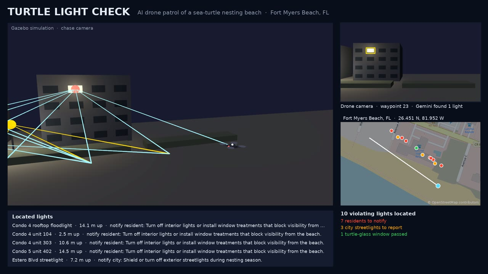

# Turtle Light Check

Finds the lights that pull sea turtle hatchlings away from the Gulf, says who has to fix each one, and puts them on a map of Fort Myers Beach.

[](sim/demo.mp4)

Click the image for the 26 second demo (`sim/demo.mp4`).

Built in one morning for the H{AI}ckathon at FGCU, challenge "AI for SWFL".

## The pitch

Hatchlings find the Gulf by heading for the brightest horizon. A porch light or an unshielded streetlight behind the dunes wins that contest, and the turtles crawl inland. Lee County and the Town of Fort Myers Beach have lighting rules for nesting season (May 1 to October 31, 9 p.m. to 7 a.m.), but checking them means someone walking the beach at night with a flashlight and a clipboard.

Turtle Light Check does the walk with a camera. A drone, or a resident's phone, photographs the beach at night. Gemini looks at each photo the way a code officer would: which lights can be seen from the sand, which windows are behind compliant turtle glass, and what the owner should change. Lights seen from several drone positions are triangulated to within about half a meter, and the map shows each one with its photo, its height, and a fix written for the person who controls it: the resident for a condo window, the city for a streetlight.

## What's in the repo

The project has two parts that share one data format.

The web app is for people on the ground. You upload a night photo of a beach-facing building, Gemini marks every light that breaks the rules and explains why, and the result lands on a satellite map next to the drone's findings.

The drone simulation shows what the same idea does at the scale of a whole beach. A Gazebo drone flies about 190 m of Fort Myers Beach at night, Gemini reads its 25 photos, and the pipeline turns boxes in photos into latitude, longitude and height for every light.

Both write GeoJSON points with the same properties, so the map draws photo results and drone results the same way.

## How the drone pipeline works

1. Fly. A Gazebo Harmonic drone moves along the shoreline at 9 m altitude and stops every 8 m, facing inland. Its camera takes a 1280x720 photo at each of 25 waypoints. Each waypoint's GPS position is known.
2. Ask Gemini. The photos go to Gemini 9 at a time (3 requests per flight). The prompt gives it the local rules and asks for a JSON list per photo: a box around each light, what kind of light it is, whether it complies, which rule applies, how severe it is, and one sentence telling the owner what to change.
3. Turn pixels into rays. With a pinhole camera model, the center of each box becomes a ray leaving the drone's known position.
4. Triangulate. Because the drone flies a straight line facing inland, two photos a few meters apart form a stereo pair: the same light stays on the same image row and shifts sideways by an amount that depends on its distance. Each pair of photos proposes a 3D point. A proposal survives only if it lands on Gemini boxes in other photos too, which throws out wrong pairings and boxes Gemini invented. A least-squares fit over every photo that saw the light gives the final position.
5. Name the owner. The located point is matched to the nearest building unit or streetlight (in a real deployment this would be a parcel lookup), and the light is assigned to a resident or to the city.
6. Map it. `sim/detections.geojson` holds one point per light with its photos and the bearing from each drone position, and `sim/flight.geojson` holds the drone track. The web map reads both directly.

Compliant lights, such as a window behind turtle glass, are triangulated the same way but written with severity `ok`, no one to notify, and a green pin.

## Lee County rules in the prompt

- Any artificial light source directly visible from the beach is a violation.
- Windows with tinted glass at 45% visible light transmittance or less comply. Fort Myers Beach also requires window coverings.
- Lee County's shadow rule (LDC 14-73) presumes a violation when artificial light casts a shadow of an object onto nesting habitat. Gemini is asked about shadows and reports them, but the simulation does not locate them yet (see limits below).

The rule wording came from the Town of Fort Myers Beach Sea Turtles page and secondary copies of the county code, because the county site blocks automated access. Check it against the code before relying on it.

## Results from the simulation

The simulated beach has five condos, three streetlights, a rooftop floodlight, ten lights that break the rules, and one lit window behind turtle glass. On the last flight:

| | |
|---|---|
| Violating lights found | 10 of 10 |
| False alarms | 0 |
| Mean location error | 0.56 m |
| Turtle-glass window | marked compliant, not flagged |
| Gemini requests | 3 |

`sim/test_locate.py` checks the geometry without Gazebo or Gemini: exact boxes, boxes jittered by 5 and 10 pixels, 20% of boxes missing, and three invented boxes per photo. At 5 pixels of jitter every light is found and the worst error is under 0.7 m.

## Tech stack

| Area | Used |
|---|---|
| Simulation | Gazebo Harmonic (gz-sim 8), SDF world generated from Python, OGRE 2 headless rendering on the GPU, gz-transport Python bindings |
| AI | Google Gemini through the `google-genai` SDK (sim) and the REST API (web), JSON response mode; `gemini-3.5-flash-lite` with `gemini-3.8-flash` as the web fallback |
| Geometry | Pinhole projection, two-view triangulation, multi-view verification, least squares; pure Python, no NumPy |
| Location | Real coordinates and shoreline angle at the Lani Kai next to the Fort Myers Beach pier, taken from OpenStreetMap |
| Web app | React 19, Vite 8, TypeScript, react-leaflet with satellite tiles, React Three Fiber (three.js) for the 3D beach hero, exifr for photo GPS |
| API | Vercel serverless function (`api/analyze.ts`): 20 s timeout per call, retries on 429, 500 and 503, then falls back to a second model |
| Video | Pillow overlays and FFmpeg (`imageio-ffmpeg`) over Gazebo chase-camera frames, OpenStreetMap basemap |
| Packaging | Docker image (Ubuntu 24.04) for the simulation, Vercel for the web app |

## Run it

Web app:

```bash
cp .env.example .env        # add GEMINI_API_KEY
pnpm install
pnpm dev                    # http://localhost:5173
```

Drone simulation (needs Docker, and a GPU for rendering):

```bash
docker build -t turtle-sim sim/
sim/run.sh                  # shell inside the container, sim/ mounted at /sim
python3 scene.py            # writes world.sdf
gz sim -r world.sdf &       # Gazebo window
python3 fly.py              # fly, ask Gemini, write the GeoJSON
python3 demo.py             # replay the flight with sight lines and markers
```

`sim/README.md` covers the output fields, the video render, and Gemini's free-tier quota (20 requests per model per day; the sim caches answers so reruns cost nothing).

## Repository layout

| Path | Contents |
|---|---|
| `src/` | React app: photo analyzer, Leaflet map, 3D hero, Lee County rules text |
| `api/analyze.ts` | Gemini photo analysis behind the web app |
| `sim/` | Gazebo world, drone flight, Gemini calls, triangulation, demo and video |
| `backend/` | FastAPI test bench used to compare Gemini models on sample photos; not used by the app |
| `docs/` | README images |

## Limits and next steps

- The buildings in the simulation are boxes. The location, shoreline angle and map are real.
- Shadows are reported by Gemini but not located: the umbrella's shadow sits at the bottom edge of the drone's frame, where clipped boxes scatter by several meters. Tilting the drone camera down would fix that.
- Matching a light to an owner uses the simulation's building list. A real deployment would use Lee County parcel data.
- A real flight needs FAA rules for night drone operations and permission from the town.

## Team

Built by Sean Peppers, Jackson Bryant, Ishita and Lpmcelduff at FGCU, November 2, 2026. Map data © OpenStreetMap contributors.
